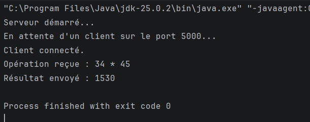
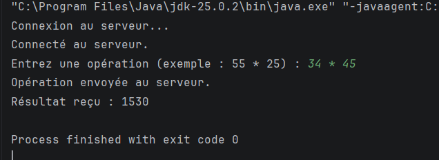
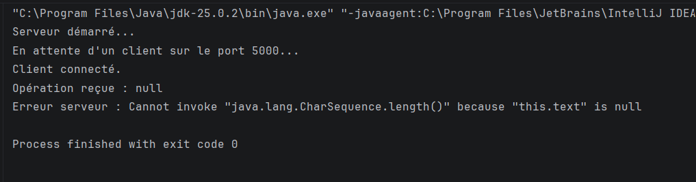
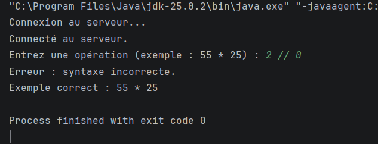
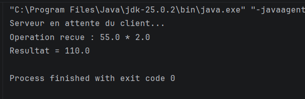
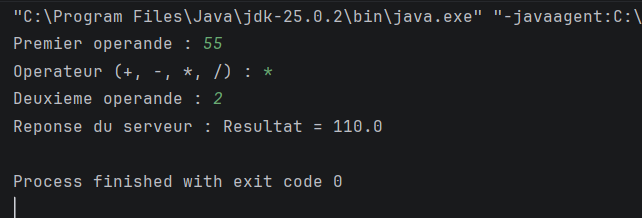

# TP2 — Les sockets TCP : échange de chaînes de caractères et d'objets

**Matière :** Développement d'applications réparties

**Niveau :** LSI3

**Environnement :** Java, IntelliJ IDEA

## Objectif du TP

Ce TP a pour objectif de mettre en pratique la communication entre un client et un serveur en Java à l'aide des sockets TCP.

Deux méthodes d'échange sont étudiées :
- L'échange de chaînes de caractères.
- L'échange d'objets Java avec l'interface `Serializable`.

---

# Partie 1 — Activité 2-1 : Échange de chaînes de caractères

## Objectif

Permettre au client d'envoyer une opération arithmétique complète au serveur. Le serveur effectue le calcul et renvoie le résultat au client.

## Fonctionnement

1. Le serveur démarre et attend une connexion.
2. Le client se connecte au serveur.
3. Le client saisit une opération arithmétique.
4. Le client envoie l'opération au serveur.
5. Le serveur effectue le calcul.
6. Le serveur renvoie le résultat au client.

## Opérations disponibles

- Addition : `+`
- Soustraction : `-`
- Multiplication : `*`
- Division : `/`

Le programme vérifie également la syntaxe des opérations et gère la division par zéro.

## Captures d'écran

### 1. Exécution du serveur

Le serveur démarre et attend la connexion du client.

### 2. Opération réussie

Exemple : `34 * 23`

Résultat attendu : `782`

### 3. Division par zéro

Exemple : `34 / 0`

Le programme affiche un message d'erreur pour signaler que la division par zéro est impossible.

---

# Partie 2 — Activité 2-2 : Échange d'objets Java

## Objectif

Réaliser un échange d'objets entre un client et un serveur en utilisant les sockets TCP et l'interface `Serializable`.

## Fonctionnement

1. Créer une classe `Operation` qui implémente `Serializable`.
2. Le client crée un objet contenant le premier opérande, l'opérateur et le deuxième opérande.
3. Le client envoie cet objet au serveur.
4. Le serveur reçoit l'objet et récupère ses données.
5. Le serveur effectue le calcul demandé.
6. Le serveur renvoie le résultat au client.
7. Le client reçoit et affiche le résultat.

## Captures d'écran

### 1. Exécution du serveur

### 2. Exécution du client

Le client envoie un objet représentant une opération et affiche le résultat reçu.

---

# Conclusion

Ce TP m'a permis de comprendre la communication client-serveur avec les sockets TCP en Java, ainsi que deux méthodes d'échange de données : les chaînes de caractères et les objets Java sérialisables.

J'ai également mis en pratique le calcul côté serveur, la validation des opérations et la gestion des erreurs.
